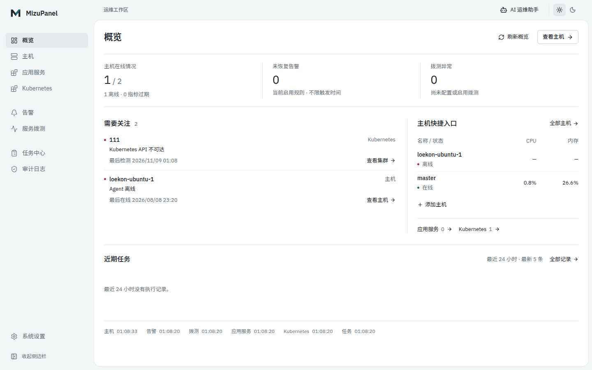
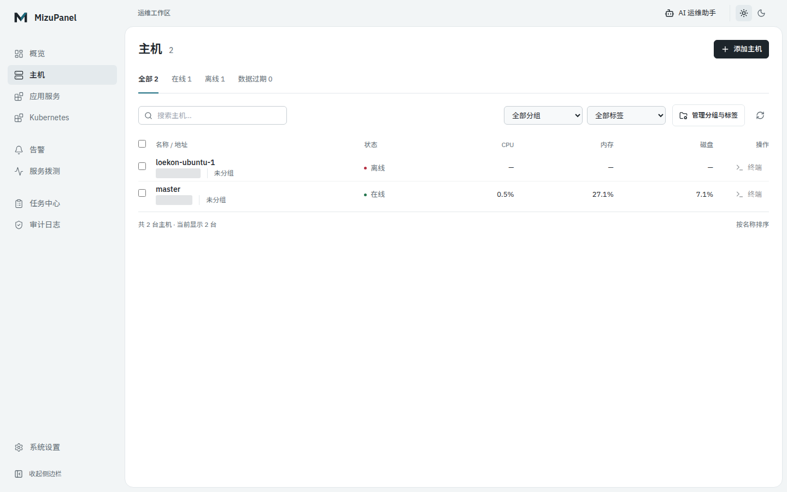
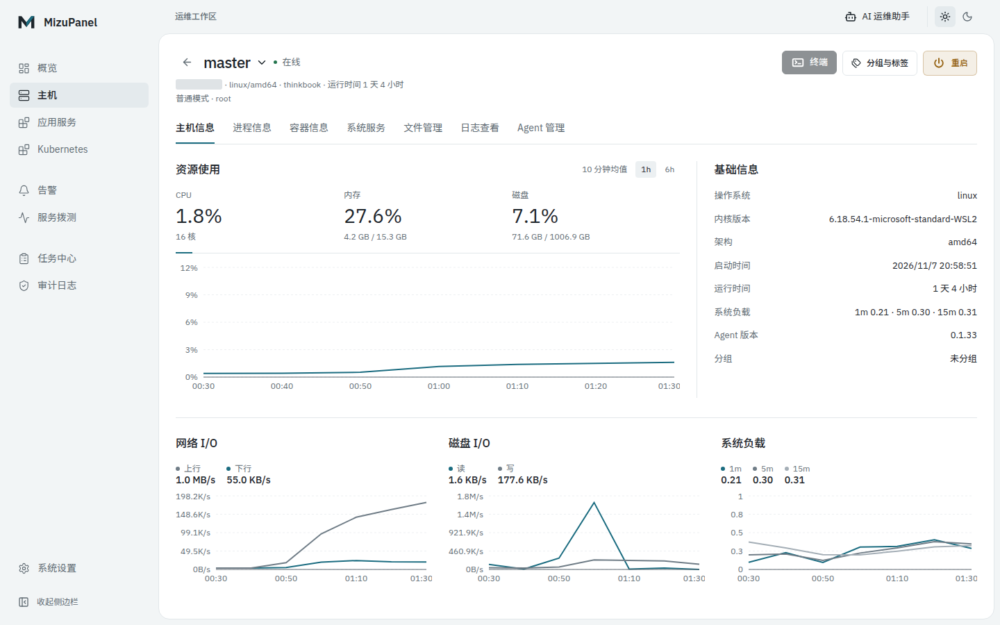
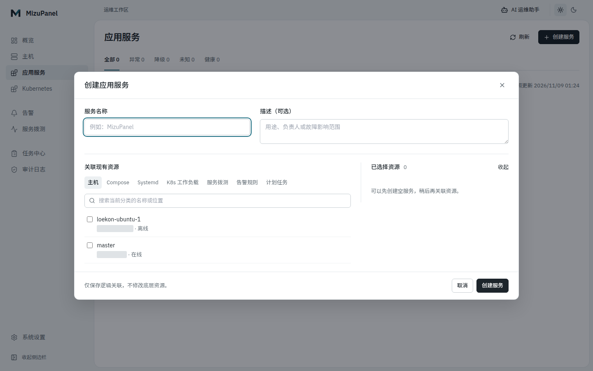
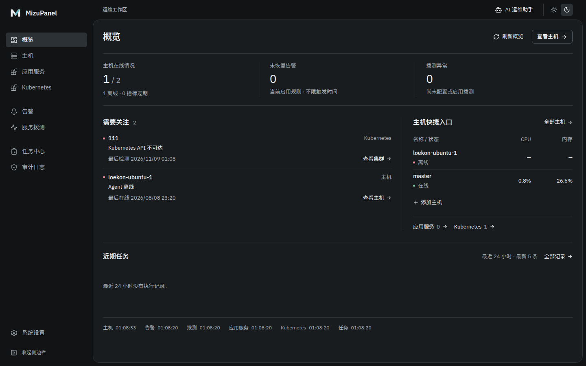
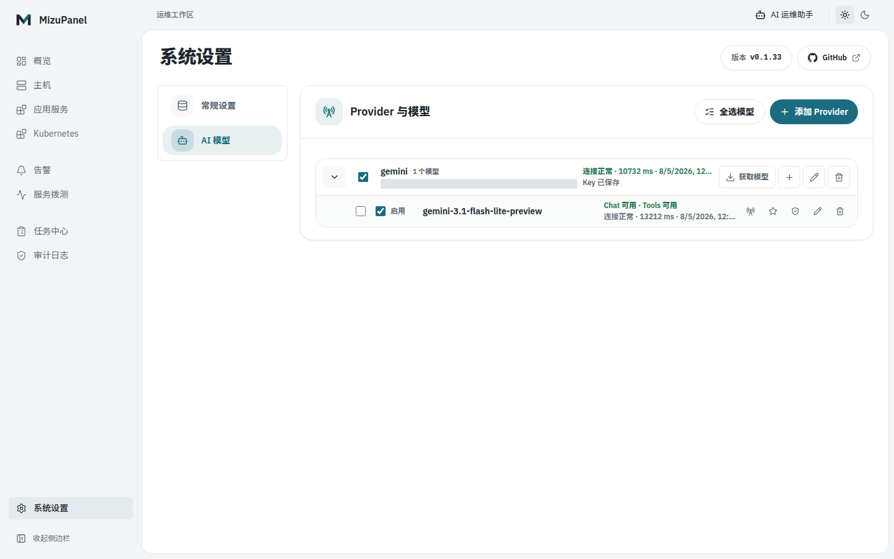
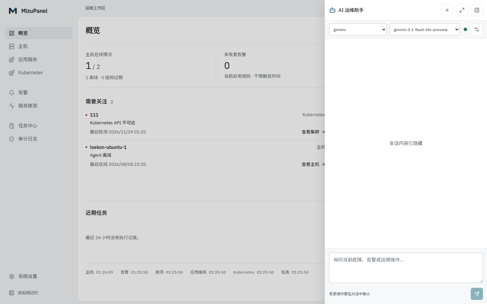

<p align="center">
  
</p>

<h1 align="center">MizuPanel</h1>

<p align="center">
  A lightweight self-hosted operations panel for application services, hosts, Docker, systemd, automation tasks, alerts, uptime monitoring, operational auditing, and Kubernetes resources, with an AI assistant for natural-language operations.
</p>

<p align="center">
  <a href="README.md">中文</a> · English
</p>

<p align="center">
  <a href="https://go.dev/"></a>
  <a href="https://react.dev/"></a>
  <a href="https://vite.dev/"></a>
  <a href="https://www.sqlite.org/"></a>
  <a href="https://www.docker.com/"></a>
  
</p>

<p align="center">
  <a href="assets/screenshots/overview-light.png">
    
  </a>
</p>

<p align="center">
  MizuPanel uses a Server + Dashboard + Agent architecture. Agents actively connect to the Server, report metrics, and carry allowed operations, while the Server probes services reachable from its own network. It is designed for personal servers, homelabs, small host fleets, and lightweight Kubernetes management.
</p>

<table>
  <tr>
    <td width="33%">
      <a href="assets/screenshots/hosts.png"></a>
      <br /><sub>Host list</sub>
    </td>
    <td width="33%">
      <a href="assets/screenshots/host-overview.png"></a>
      <br /><sub>Host overview</sub>
    </td>
    <td width="33%">
      <a href="assets/screenshots/service-editor.png"></a>
      <br /><sub>Application service editor</sub>
    </td>
  </tr>
  <tr>
    <td width="33%">
      <a href="assets/screenshots/overview-dark.png"></a>
      <br /><sub>Overview — dark theme</sub>
    </td>
    <td width="33%">
      <a href="assets/screenshots/settings-models.png"></a>
      <br /><sub>AI model settings</sub>
    </td>
    <td width="33%">
      <a href="assets/screenshots/ai-assistant.png"></a>
      <br /><sub>AI assistant</sub>
    </td>
  </tr>
</table>

Screenshots: **v0.1.33**, captured on **2026-11-09** at 1440 × 900. These are real local pages with the new SVG logo; IP addresses, Provider endpoints, and conversation content are redacted where needed. Empty and offline states are not replaced with mock data. See the [full screenshot gallery](docs/screenshots.en.md).

<p align="center"><strong>Features</strong></p>

<table>
  <tr>
    <td width="33%"><strong>Host Monitoring</strong><br /><sub>Node status, CPU, memory, disk, network, load, and historical trends.</sub></td>
    <td width="33%"><strong>Host Fleet Management</strong><br /><sub>Groups, tags, search and filters, single-host editing, and multi-host batch operations.</sub></td>
    <td width="33%"><strong>Agent Lifecycle</strong><br /><sub>Install, connection diagnostics, logs, restart, persistent identity, and secure latest-version upgrades.</sub></td>
  </tr>
  <tr>
    <td width="33%"><strong>Docker Workspace</strong><br /><sub>Containers, guarded Compose app deploy/update/rollback/archive, images, volumes, networks, logs, and terminals.</sub></td>
    <td width="33%"><strong>Host Operations</strong><br /><sub>Processes, systemd services, file management, web terminals, and controlled reboots.</sub></td>
    <td width="33%"><strong>Alerts And Notifications</strong><br /><sub>Metric rules, trigger and recovery delivery, Webhook, DingTalk, Feishu, retries, and delivery history.</sub></td>
  </tr>
  <tr>
    <td width="33%"><strong>Kubernetes Management</strong><br /><sub>Cluster access, resource summary, Namespace, Node, Pod, Workload, Service, and Ingress views.</sub></td>
    <td width="33%"><strong>K8s Diagnostics</strong><br /><sub>Pod logs, Events, Describe output, YAML view/edit, and resource actions.</sub></td>
    <td width="33%"><strong>Resource Creation</strong><br /><sub>Deployment, Pod, Service, Ingress, ConfigMap, Secret, PVC, Job, and CronJob.</sub></td>
  </tr>
  <tr>
    <td colspan="3"><strong>Application Service Center</strong><br /><sub>Group hosts, Compose, systemd, Kubernetes workloads, uptime monitors, alert rules, and scheduled tasks into business services with one health, location, and activity view.</sub></td>
  </tr>
  <tr>
    <td colspan="3"><strong>Scheduled Tasks And Script Library</strong><br /><sub>Store Shell scripts centrally, run them on one or more Agents with standard five-field Cron schedules and explicit time zones, and inspect per-node status, duration, and bounded output.</sub></td>
  </tr>
  <tr>
    <td colspan="3"><strong>Uptime Monitoring</strong><br /><sub>Server-originated scheduled or manual HTTP, HTTPS, and TCP checks with status, latency, TLS certificate-expiry warnings, and failure/recovery notifications through existing channels.</sub></td>
  </tr>
  <tr>
    <td colspan="3"><strong>Audit Trail</strong><br /><sub>Records the time, result, actor type, target, and node for sensitive operations, with filters, incremental pagination, and safe details in the Audit page; request bodies, secrets, terminal commands, and terminal output are not recorded.</sub></td>
  </tr>
  <tr>
    <td colspan="3"><strong>Unified Log Center</strong><br /><sub>Query Docker containers, Systemd services, Kubernetes Pods, Agents, the Server, and host log files from one desktop workspace; search, copy, download, and follow Docker/file output in real time.</sub></td>
  </tr>
  <tr>
    <td colspan="3"><strong>AI Natural-Language Operations</strong><br /><sub>Query incidents, alerts, nodes, services, uptime, metrics, and bounded logs from a global drawer or full workspace; switch OpenAI Chat Completions compatible models while requiring explicit confirmation for every state change.</sub></td>
  </tr>
</table>

<strong>Overview And Host Workspace</strong>

The default homepage (`/`) is an operations overview: host availability, unresolved alerts from enabled rules, probe issues, cross-resource attention items, stable host shortcuts, and the latest five task runs from the last 24 hours. Missing, stale, and failed data sources are labeled separately instead of being shown as healthy or zero.

The host list (`/nodes`) remains directly accessible. Hosts keep stable name ordering; details use the full workspace width, with resource trends, processes, Docker/Compose, Systemd, files, logs, and Agent operations in separate sections. Switching hosts preserves the current section while isolating target data, and leaving unsaved file or Compose edits requires confirmation.

<strong>Application Service Center</strong>

The top-level **Application Services** page (`/services`) is a logical operations view over existing resources. A service can link hosts, Compose projects, systemd services, Kubernetes Deployments/StatefulSets/DaemonSets, uptime monitors, alert rules, and scheduled tasks, then aggregate readable reasons, deployment locations, and recent activity into unhealthy, degraded, healthy, or unknown status.

The service list uses stable name sorting and status filters. Details combine current problems, associated resources, and a category-filtered timeline of the latest eight supplied events. The editor supports resource-type switching, search, a cross-category selection list, and unsaved-change protection. Manual health rechecks may run linked probes and send their existing notifications; AI diagnosis prepares a draft without sending it.

Application services never copy or take ownership of the linked resources. The detail page only deep-links into their existing management surfaces, and deleting an application service removes only the logical service and its associations. If an Agent or Kubernetes query fails, other resource results still return while that scope is shown as temporarily unavailable.

<strong>Scheduled Tasks And Script Library</strong>

The top-level **Task Center** (`/tasks`) provides Scheduled Tasks, Script Library, and Run History views. Scripts can run manually across up to 100 target nodes. Schedules use standard five-field Cron expressions with separate IANA time zones, can be enabled, paused, or triggered immediately, and reuse Webhook, DingTalk, and Feishu with never, failure-only, or always notification policies.

Scheduling is persisted and owned by the Server; MizuPanel never reads or changes an existing host `crontab`. Multiple periods missed while the Server is stopped collapse into at most one catch-up run, and an occurrence overlapping the previous run is recorded explicitly as `skipped`. Agents execute fixed `/bin/sh <temporary-script>` argv with a 128 KiB script limit, 64 KiB combined-output limit, 300-second default timeout, and 1,800-second maximum. Offline nodes and older Agents without the capability receive distinct results.

Run history is retained for 30 days by default and cleaned hourly:

```yaml
tasks:
  retention: "30d"
  cleanup_interval: "1h"
```

Docker deployments can override these values with `MIZUPANEL_TASK_RETENTION` and `MIZUPANEL_TASK_CLEANUP_INTERVAL`. Script content, execution output, and notification credentials are excluded from audit events. See the [configuration docs](docs/configuration.en.md) for the full configuration and API boundary.

<strong>Audit Trail</strong>

The top-level **Audit Trail** page (`/audit`) follows the existing admin-auth configuration and provides time, module, node, result, and keyword filters. Its read-only Dashboard API is `GET /api/audit/events`, with cursor pagination and filters for time, actor, module, action, node, result, and safe target/summary keywords.

The **Cleanup Logs** action can retain the latest N days or permanently delete matching old rows before an exact cutoff. It always protects the latest 24 hours, and a successful cleanup leaves a safe audit event containing only the normalized cutoff and deleted count.

Events are retained for 90 days by default and expired rows are cleaned hourly:

```yaml
audit:
  retention: "90d"
  cleanup_interval: "1h"
```

Docker deployments can override these values with `MIZUPANEL_AUDIT_RETENTION` and `MIZUPANEL_AUDIT_CLEANUP_INTERVAL`. Audit persistence is best-effort after an operation and does not replace that operation's response if writing the event fails. This is operational evidence, not a compliance-grade immutable ledger, and it does not provide multi-user/RBAC attribution, export, or terminal command capture. See the [configuration docs](docs/configuration.en.md) for the full configuration, API parameters, and data boundary.

<strong>Unified Log Center</strong>

The top-level **Log Center** (`/logs`) brings the existing on-demand log entries into one single-target workspace: Docker containers, Systemd services, Kubernetes Pods, Agents, the Server process, and host log files. Every source can be refreshed manually; Docker and file logs retain their existing WebSocket follow behavior. Keyword filtering only applies to the currently loaded browser result, which can also be copied or downloaded locally.

Log content is read on demand: it is not written to SQLite, centrally collected, or indexed, and opening logs does not add their contents to audit details. Server logs are limited to the current process's in-memory buffer (about 10,000 records / 2 MiB) and disappear on restart. Systemd, Agent, Kubernetes, and Server logs are bounded snapshots rather than simulated live streams.

<strong>AI Natural-Language Operations Assistant</strong>

The top-bar **AI Operations Assistant** opens as an overlay drawer and can expand into the full `/ai` workspace. Each OpenAI Chat Completions compatible Provider stores one Base URL and optional API Key while managing multiple child models. Model IDs can be discovered and selectively imported or added manually, then verified one at a time for chat and tool support. Conversations select a Provider first and then one of its models, persist that model across reloads, and support explicit global default and one-shot pre-tool fallback routing.

The model can only select from a fixed Server-owned operations registry. It can search nodes, Docker, Compose, Systemd, Kubernetes, application-service, task, alert, and uptime resources on demand, inspect direct relationships backed by real identifiers, and retain proposal-time known impact in mutation plans. Incident, alert, node, service, uptime, metric, and bounded-log queries may run automatically. Host reboot, Agent upgrade, Docker/Compose/Systemd state changes, and existing saved-script runs must display their target and impact and receive explicit administrator confirmation. The resource graph is discovery and impact guidance only; every mutation requires confirmation in the AI conversation, with no separate autonomous-execution policy settings. Arbitrary Shell, file writes/deletes, resource deletion, and Kubernetes writes are not expressible through the registry.

Provider API Keys are encrypted by the Server using `data/ai.key`; read APIs return neither plaintext nor ciphertext. Fallback applies only once to a transient timeout, rate limit, or upstream-availability failure on the first model call before any tool work. Authentication, protocol, cancellation, and post-tool failures never fall back. Backups and migrations must preserve the database and `ai.key` together. System prompts, raw model responses, raw tool output, and log content are not persisted as conversation history. See the [configuration docs](docs/configuration.en.md) for the complete setup and data boundary.

<strong>Deploy With Docker</strong>

Release images are published on Docker Hub. A target host needs only Docker Engine and Docker Compose—no repository checkout, Go, or Node.js. The repository Compose file pins the immutable `leokon3/mizupanel:0.1.33` image:

```bash
mkdir -p mizupanel && cd mizupanel
curl -fLO https://raw.githubusercontent.com/LeoKon3/MizuPanel/v0.1.33/docker-compose.yml
docker compose pull
docker compose up -d
```

To expose the panel on the server IP or LAN, recreate it with `MIZUPANEL_BIND_ADDR=0.0.0.0 docker compose up -d`. See the [configuration docs](docs/configuration.en.md) for upgrades, rollback, MySQL, database and `ai.key` backups, and custom image references. `latest` is convenient for evaluation only; production deployments should pin a SemVer image.

<strong>Run From Release Package</strong>

Prefer the prebuilt package from GitHub Releases. Download the package that matches the Server machine:

```bash
# x86_64 / amd64
curl -LO https://github.com/LeoKon3/MizuPanel/releases/latest/download/mizupanel-linux-amd64.tar.gz

# ARM64 / aarch64
curl -LO https://github.com/LeoKon3/MizuPanel/releases/latest/download/mizupanel-linux-arm64.tar.gz
```

If you want to build from source locally, run:

```bash
# x86_64 / amd64
make package-linux-amd64

# ARM64 / aarch64
make package-linux-arm64
```

Extract the package and prepare local config:

```bash
tar -xzf mizupanel-linux-amd64.tar.gz
cd mizupanel-linux-amd64
cp server.example.yaml server.yaml
```

If Agents will access the panel from other machines, set the panel URL in `server.yaml` first:

```yaml
server:
  listen: ":8080"
  public_url: "http://your-server-ip:8080"
```

Start the Server:

```bash
./mizupanel-server -config server.yaml
```

Check the Server or installed Agent version without loading configuration:

```bash
./mizupanel-server version
/usr/local/mizupanel/bin/mizupanel-agent version
```

The `--version` and `-v` aliases produce the same output.

Open `http://your-server-ip:8080`, go to **Hosts** (`/nodes`), then click **Add Host** to copy the Linux or Windows Agent install command.

The release package already includes web assets, installer scripts, and Agent downloads. Docker, MySQL, admin auth, systemd hosting, and token details are covered in the [configuration docs](docs/configuration.en.md). More interface previews are available in [screenshots](docs/screenshots.en.md).

<sub>Special thanks to the <a href="https://linux.do/">Linux.do</a> community for feedback, discussion, and inspiration.</sub>
