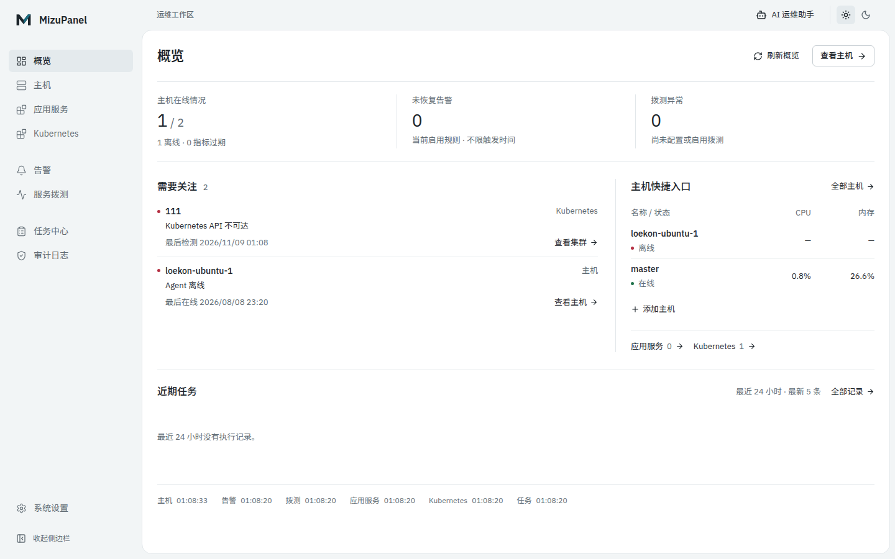

<p align="center">
  
</p>

<h1 align="center">MizuPanel</h1>

<p align="center">面向个人服务器与小型集群的自托管运维面板。</p>

<p align="center">
  中文 · <a href="README.en.md">English</a> ·
  <a href="https://github.com/LeoKon3/MizuPanel/releases">下载</a> ·
  <a href="docs/configuration.md">部署文档</a>
</p>

<p align="center">
  <a href="https://github.com/LeoKon3/MizuPanel/actions/workflows/ci.yml"></a>
  
</p>

MizuPanel 将主机监控、容器管理、服务排障和日常运维放进同一个工作区，适合个人服务器、家庭实验室及小规模多主机环境。Server 提供面板与数据存储，Agent 主动连接 Server，上报指标并执行授权的操作。默认使用 SQLite，也可连接 MySQL。

## 功能

- **主机监控与管理**：CPU、内存、磁盘、网络和历史趋势，支持分组、标签、进程、文件管理与 Web 终端。
- **Docker 与 Systemd**：管理容器、Compose 应用和系统服务，查看日志，进行部署、更新与日常维护。
- **应用服务**：将分散的主机、工作负载、拨测和告警关联成逻辑服务，集中查看健康状态、资源与近期事件。
- **Kubernetes**：查看集群与工作负载，查询日志和事件，管理 YAML 及常用资源。
- **告警与拨测**：指标告警、HTTP/HTTPS/TCP 检测、TLS 到期预警，以及故障和恢复通知。
- **自动化与审计**：脚本库、多节点任务、Cron 调度、执行记录和敏感操作审计。
- **AI 运维助手**：通过兼容 OpenAI Chat Completions 的模型查询资源、分析问题；所有变更操作都需人工确认。

## 界面预览

[](docs/screenshots.md)

支持明暗主题。[查看更多界面](docs/screenshots.md)。

## 快速开始

推荐使用 **Docker Compose**，无需安装 Go 或 Node.js。请先安装 Docker Engine 和 Compose 插件。

```bash
mkdir -p mizupanel && cd mizupanel
curl -fLO https://raw.githubusercontent.com/LeoKon3/MizuPanel/v0.1.34/docker-compose.yml
docker compose up -d
```

在运行 Docker 的机器上打开 **http://127.0.0.1:8080**。默认仅监听本机，数据保存在当前目录的 `data/` 中。

> 命令使用对应版本的已发布镜像。如果你正在查看尚未发布的源码版本，请从 [Releases](https://github.com/LeoKon3/MizuPanel/releases) 选择已发布版本，或按部署文档从源码构建。

### 接入主机

1. 在面板中进入 **主机 → 添加主机**。
2. 复制适合目标系统的 Agent 安装命令，在目标主机上执行。
3. 返回面板查看节点状态与指标。

远程 Agent 必须能访问面板地址。对外开放前，请先配置管理员认证、可达地址和 HTTPS，详见 [远程访问与认证](docs/configuration.md#remote-access)。不要把默认未启用认证的面板直接暴露到公网。

### 其他部署方式

| 方式 | 适用场景 |
| --- | --- |
| [二进制发布包](docs/configuration.md#binary) | 不使用容器，直接运行 Linux amd64/arm64 Server |
| [Docker 命令](docs/configuration.md#docker-run) | 使用 `docker run` 管理单个容器 |
| [Compose + MySQL](docs/configuration.md#mysql) | 使用 MySQL 存储面板数据 |
| [从源码构建](docs/configuration.md#build) | 本地开发、测试或自定义构建 |

## 数据与安全

- Agent 运行在被管理的主机上；终端、Docker 和任务执行能力应仅授予受信任的管理员。
- SQLite 数据目录或 MySQL 数据库，以及 AI 凭据密钥 `ai.key`，需要一起备份。升级或回滚前先备份数据。
- AI 功能是可选的。连接外部模型服务前，请确认可发送给该服务的数据范围；人工确认不会替代主机和网络权限控制。

## 文档与反馈

- [配置与部署](docs/configuration.md)：认证、Agent、MySQL、备份、升级与回滚。
- [界面截图](docs/screenshots.md)
- [更新日志](CHANGELOG.md)
- [发布流程](RELEASING.md)
- [问题反馈与功能建议](https://github.com/LeoKon3/MizuPanel/issues)

采用 [MIT 许可证](LICENSE)。感谢 [Linux.do](https://linux.do/) 社区的反馈与支持。
