# Interface preview

[Back to README](../README.en.md) · [中文](screenshots.md)

## Overview And Themes

<table>
  <tr>
    <td width="50%">
      <a href="../assets/screenshots/overview-light.png">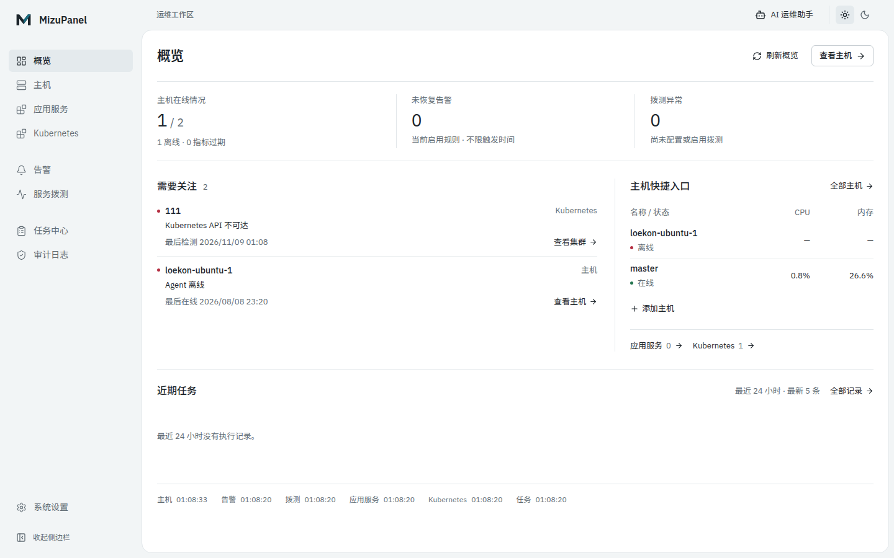</a>
       Light overview: real status summaries, attention items, and recent tasks.
    </td>
    <td width="50%">
      <a href="../assets/screenshots/overview-dark.png">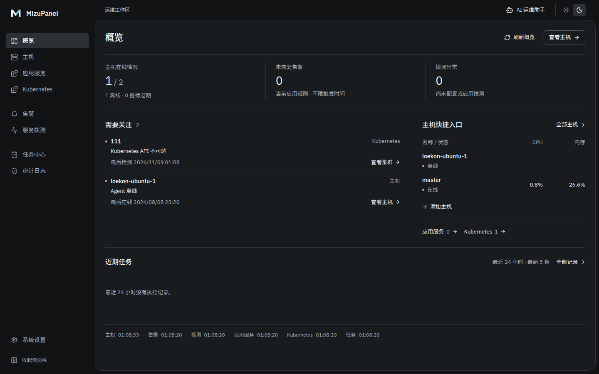</a>
       The same overview in dark mode, with the same information structure.
    </td>
  </tr>
</table>

## Host Workspace

<table>
  <tr>
    <td width="50%">
      <a href="../assets/screenshots/hosts.png">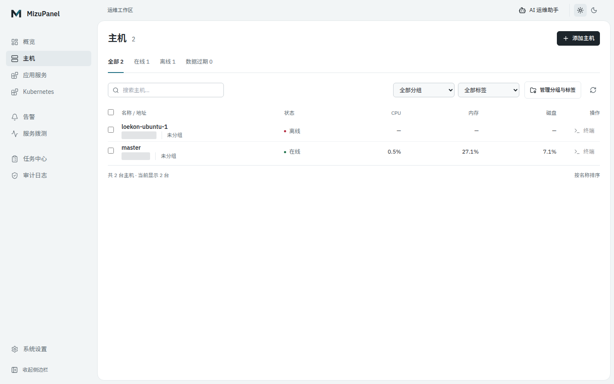</a>
       Separate host list: stable ordering, status/group filters, and live resource metrics.
    </td>
    <td width="50%">
      <a href="../assets/screenshots/host-overview.png">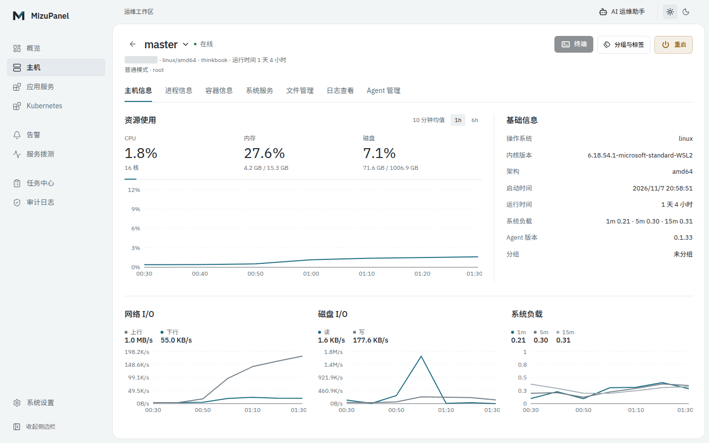</a>
       Full-width host overview: resource trends, system information, network and disk I/O.
    </td>
  </tr>
  <tr>
    <td width="100%">
      <a href="../assets/screenshots/host-processes.png">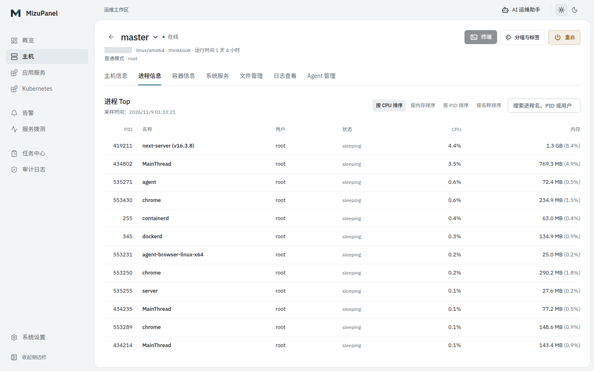</a>
       Process view: search, sorting, and aligned numeric columns.
    </td>
  </tr>
</table>

## Application Services

<table>
  <tr>
    <td width="50%">
      <a href="../assets/screenshots/application-services.png">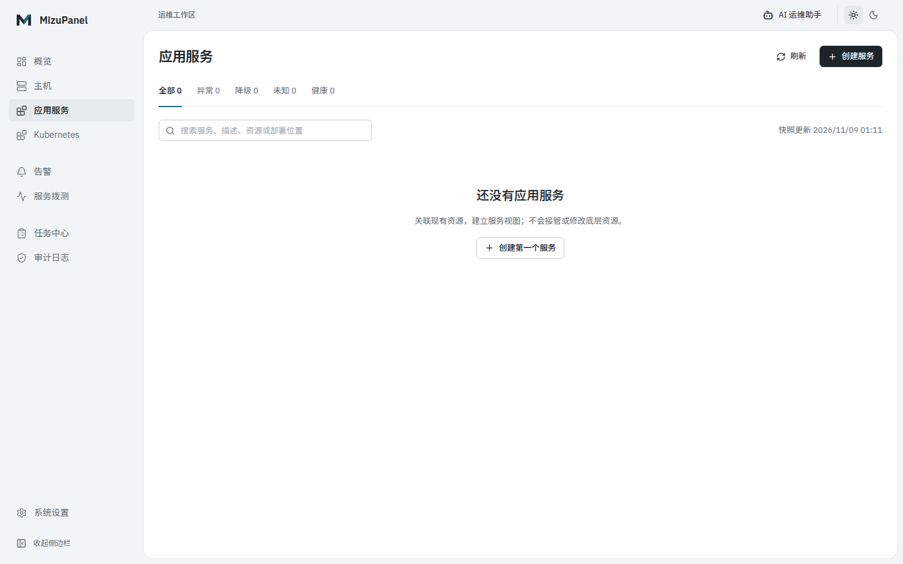</a>
       Application service list.
    </td>
    <td width="50%">
      <a href="../assets/screenshots/service-editor.png">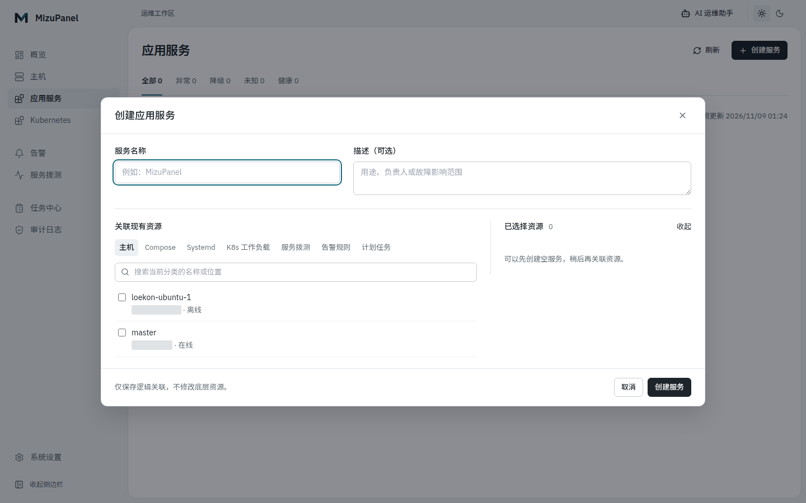</a>
       Resource editor: type-specific selection, search, and a cross-category selection list.
    </td>
  </tr>
</table>

## Alerts

<table>
  <tr>
    <td width="50%">
      <a href="../assets/screenshots/alert-history.png">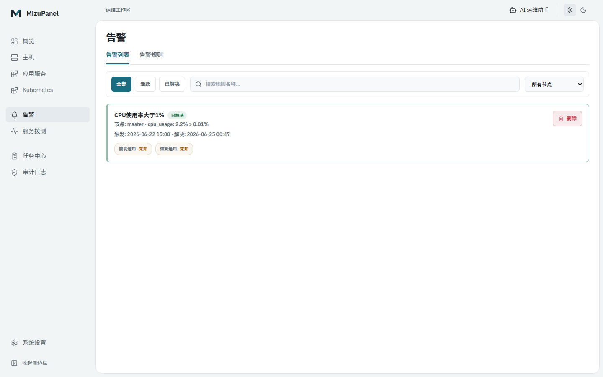</a>
       Alert history with trigger and recovery delivery states.
    </td>
    <td width="50%">
      <a href="../assets/screenshots/alert-rule-list.png">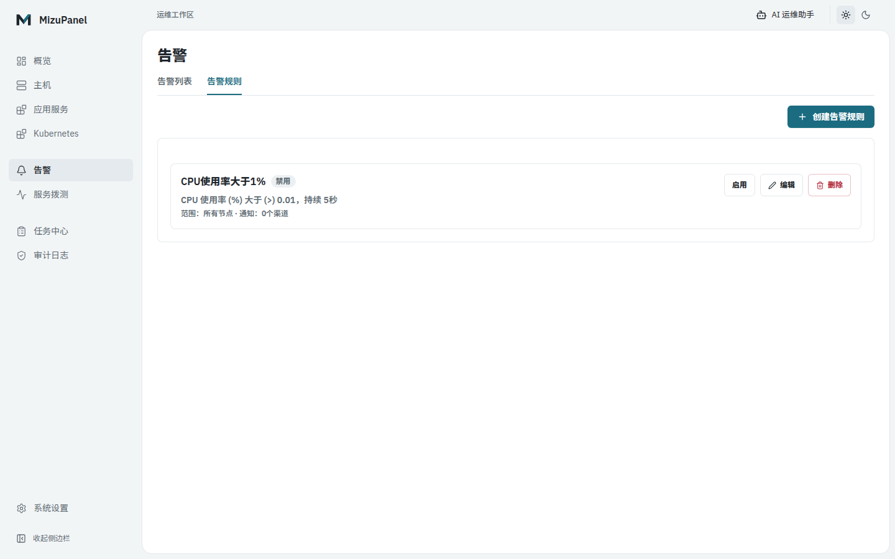</a>
       Alert rule list.
    </td>
  </tr>
</table>

## Task Center And Uptime Monitoring

<table>
  <tr>
    <td width="50%">
      <a href="../assets/screenshots/task-center.png">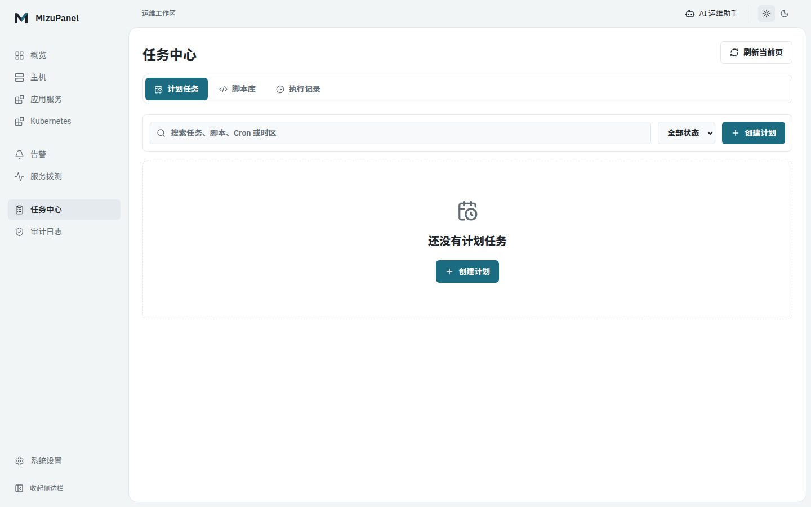</a>
       Scheduled tasks, scripts, and execution history.
    </td>
    <td width="50%">
      <a href="../assets/screenshots/uptime-monitoring.png">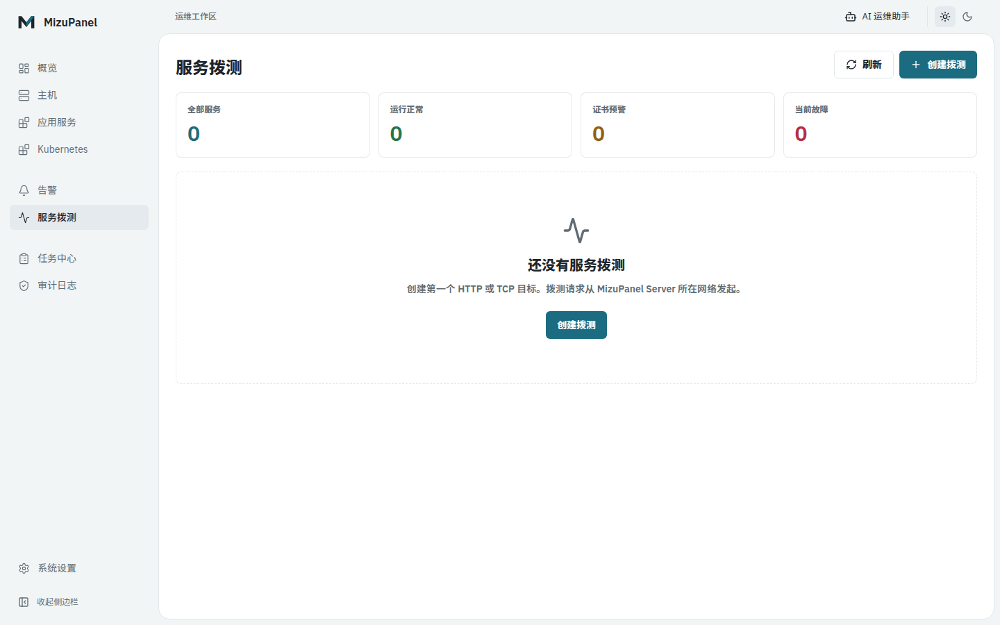</a>
       HTTP, HTTPS, and TCP uptime monitoring.
    </td>
  </tr>
</table>

## Kubernetes And Audit

<table>
  <tr>
    <td width="50%">
      <a href="../assets/screenshots/kubernetes-clusters.png">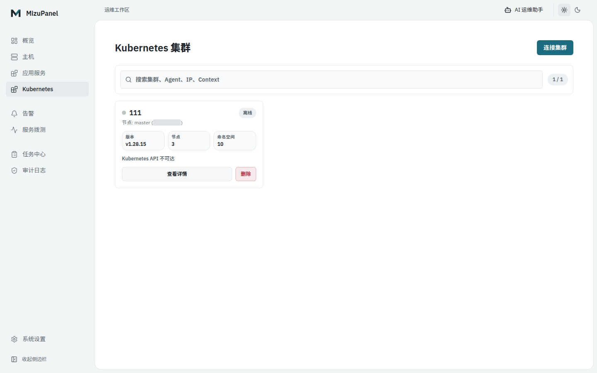</a>
       Cluster list and health status.
    </td>
    <td width="50%">
      <a href="../assets/screenshots/audit-log.png">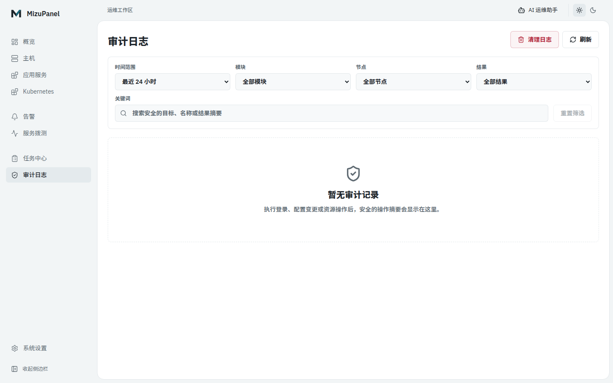</a>
       Operational audit and filters.
    </td>
  </tr>
</table>

## System Settings

<table>
  <tr>
    <td width="50%">
      <a href="../assets/screenshots/settings-general.png">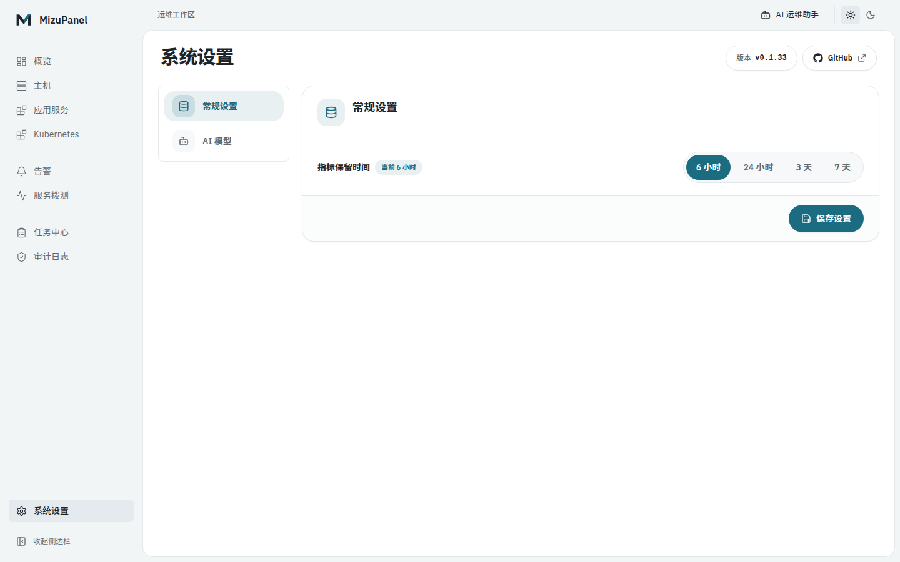</a>
       Separate general settings view: metric retention and the current version.
    </td>
    <td width="50%">
      <a href="../assets/screenshots/settings-models.png">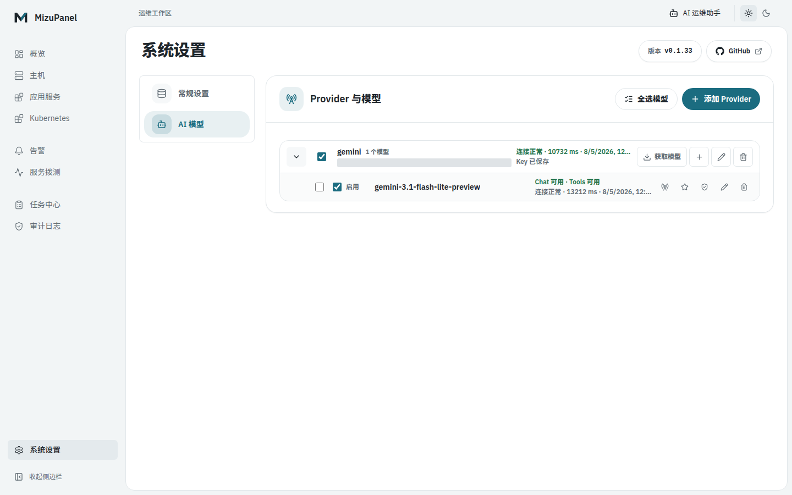</a>
       AI Provider and model management.
    </td>
  </tr>
</table>

## AI Operations Assistant

<table>
  <tr>
    <td width="100%">
      <a href="../assets/screenshots/ai-assistant.png">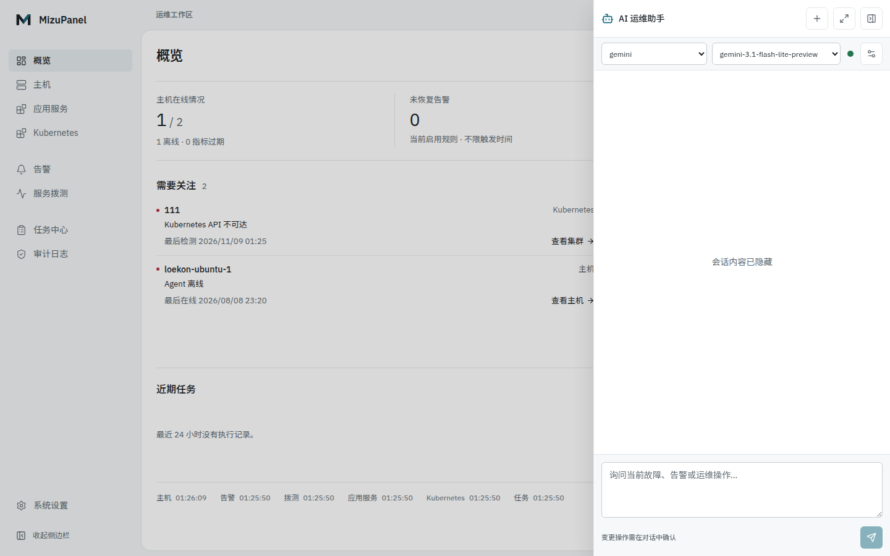</a>
       On-demand AI assistant drawer.
    </td>
  </tr>
</table>
