# 界面预览

[返回 README](../README.md) · [English](screenshots.en.md)

## 概览与明暗主题

<table>
  <tr>
    <td width="50%">
      <a href="../assets/screenshots/overview-light.png">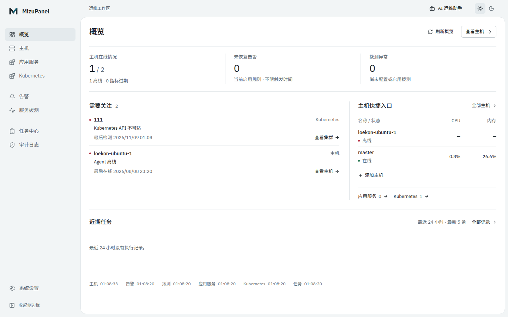</a>
       浅色概览：首页汇总真实状态、需要关注的对象和近期任务。
    </td>
    <td width="50%">
      <a href="../assets/screenshots/overview-dark.png">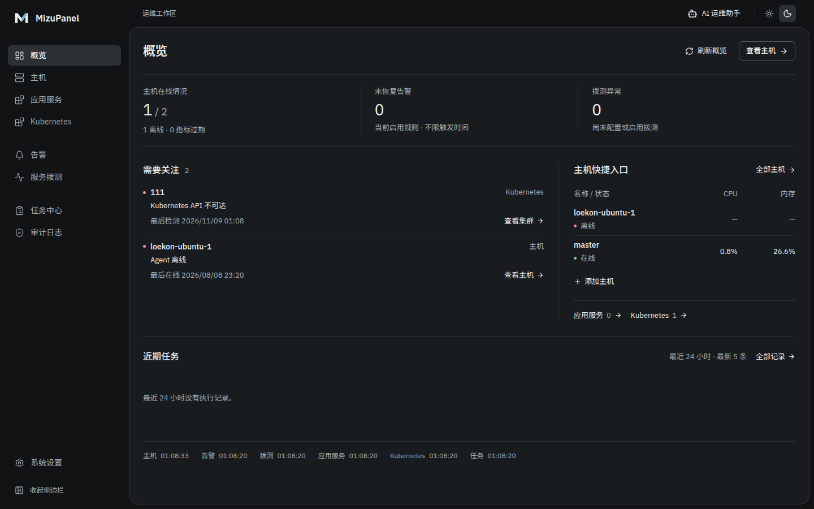</a>
       同一页面的深色主题，信息结构保持一致。
    </td>
  </tr>
</table>

## 主机工作区

<table>
  <tr>
    <td width="50%">
      <a href="../assets/screenshots/hosts.png">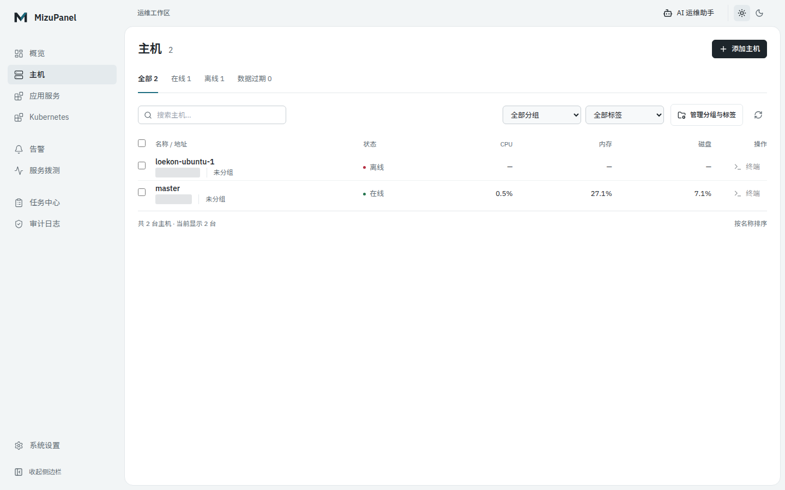</a>
       独立主机列表：稳定排序、状态与分组筛选、真实资源指标。
    </td>
    <td width="50%">
      <a href="../assets/screenshots/host-overview.png">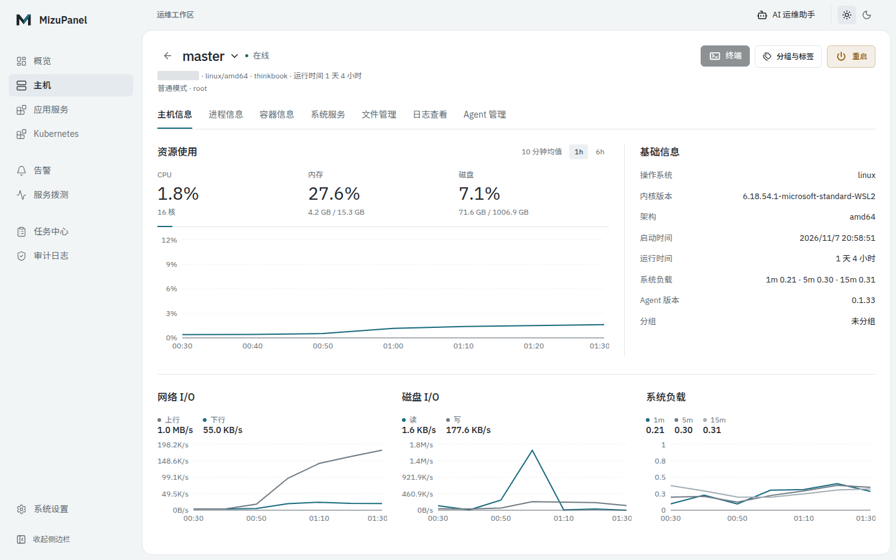</a>
       全宽主机概览：资源趋势、基础信息、网络与磁盘 I/O。
    </td>
  </tr>
  <tr>
    <td width="100%">
      <a href="../assets/screenshots/host-processes.png">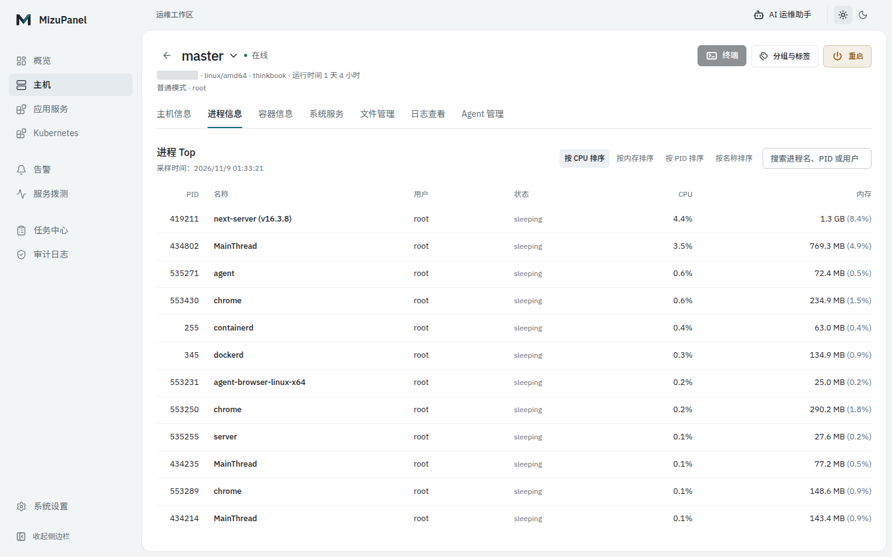</a>
       进程分区：搜索、排序和对齐的数值列。
    </td>
  </tr>
</table>

## 应用服务

<table>
  <tr>
    <td width="50%">
      <a href="../assets/screenshots/application-services.png">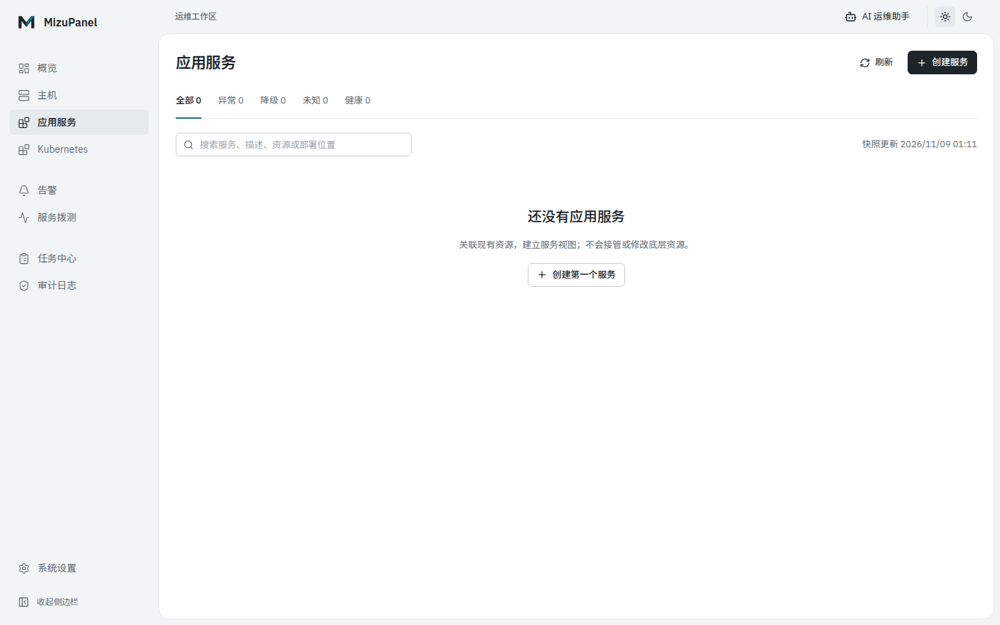</a>
       应用服务列表。
    </td>
    <td width="50%">
      <a href="../assets/screenshots/service-editor.png">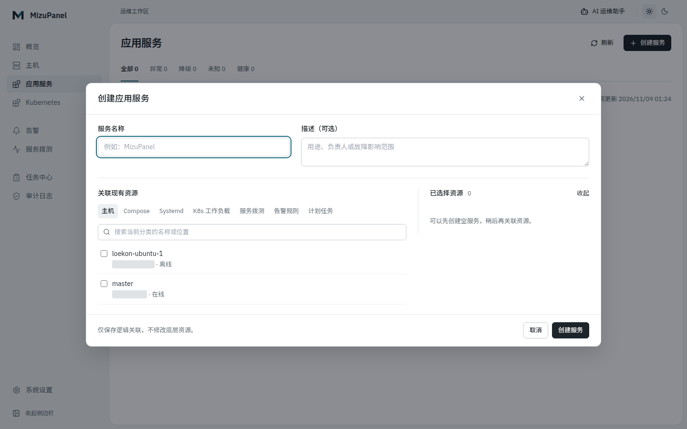</a>
       资源分类编辑器：按类型选择、搜索和查看已选清单。
    </td>
  </tr>
</table>

## 告警

<table>
  <tr>
    <td width="50%">
      <a href="../assets/screenshots/alert-history.png">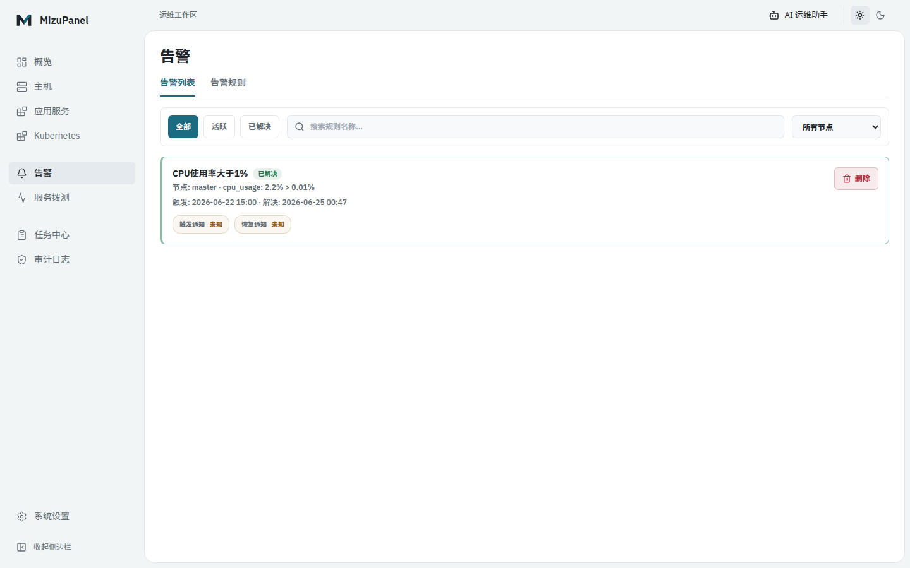</a>
       告警历史与触发、恢复通知状态。
    </td>
    <td width="50%">
      <a href="../assets/screenshots/alert-rule-list.png">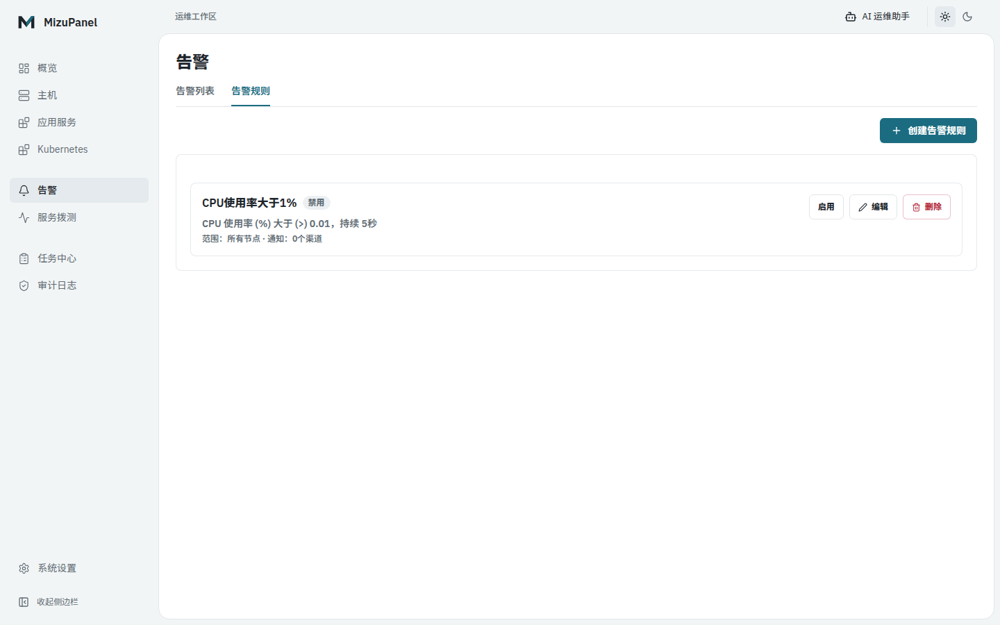</a>
       告警规则列表。
    </td>
  </tr>
</table>

## 任务中心与服务拨测

<table>
  <tr>
    <td width="50%">
      <a href="../assets/screenshots/task-center.png">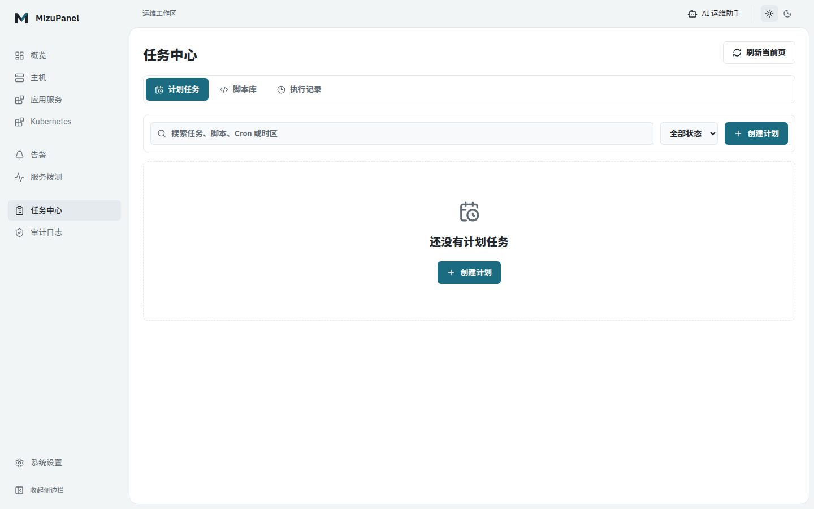</a>
       计划任务、脚本库与执行记录。
    </td>
    <td width="50%">
      <a href="../assets/screenshots/uptime-monitoring.png">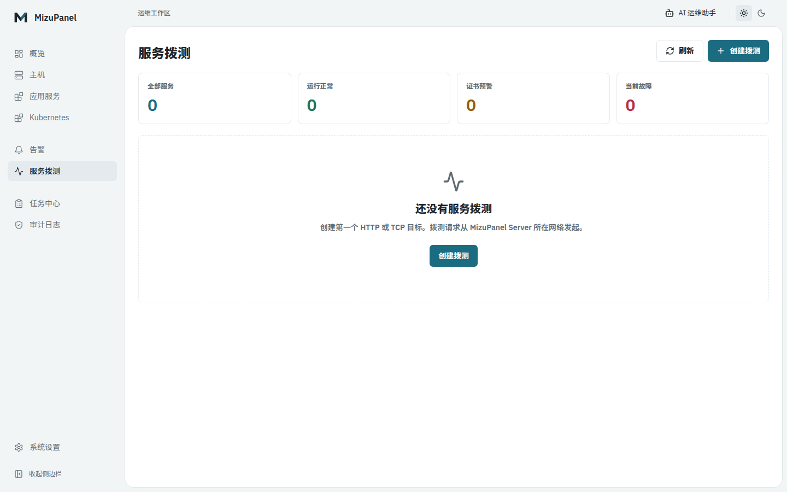</a>
       HTTP、HTTPS、TCP 服务拨测。
    </td>
  </tr>
</table>

## Kubernetes 与审计

<table>
  <tr>
    <td width="50%">
      <a href="../assets/screenshots/kubernetes-clusters.png">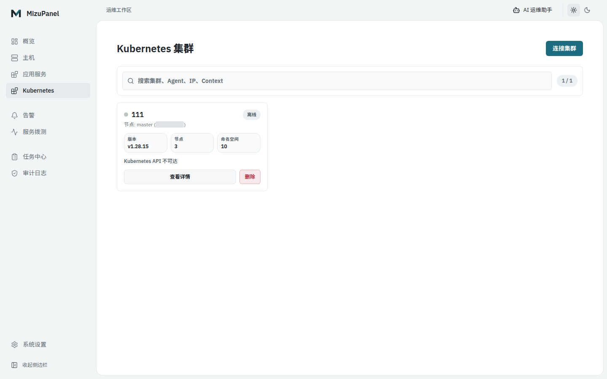</a>
       集群列表与健康状态。
    </td>
    <td width="50%">
      <a href="../assets/screenshots/audit-log.png">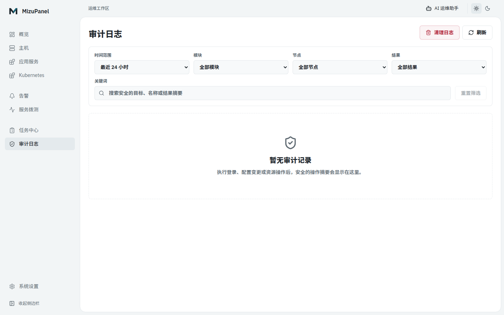</a>
       操作审计与筛选。
    </td>
  </tr>
</table>

## 系统设置

<table>
  <tr>
    <td width="50%">
      <a href="../assets/screenshots/settings-general.png">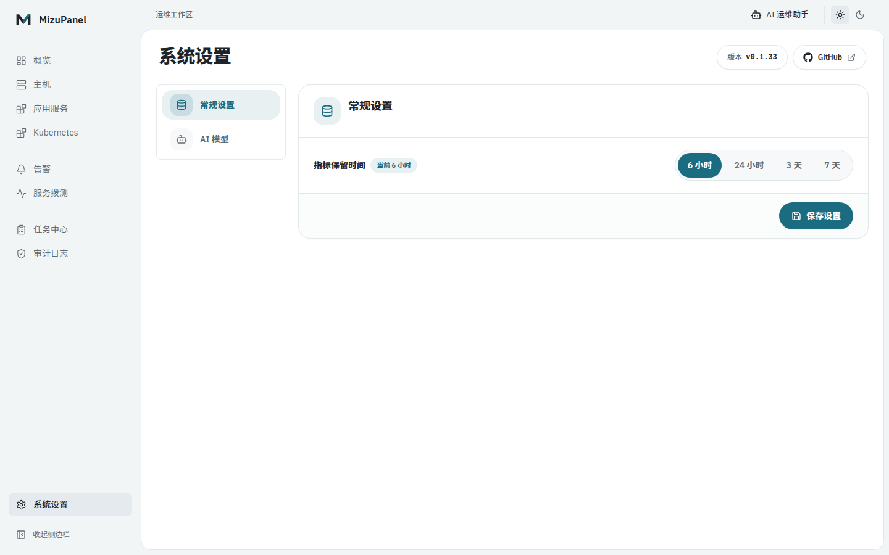</a>
       常规设置独立页面：指标保留时间与当前版本。
    </td>
    <td width="50%">
      <a href="../assets/screenshots/settings-models.png">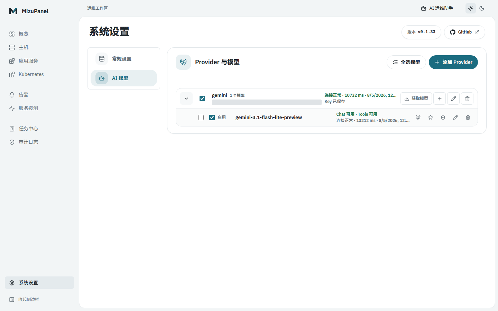</a>
       AI Provider 与模型管理。
    </td>
  </tr>
</table>

## AI 运维助手

<table>
  <tr>
    <td width="100%">
      <a href="../assets/screenshots/ai-assistant.png">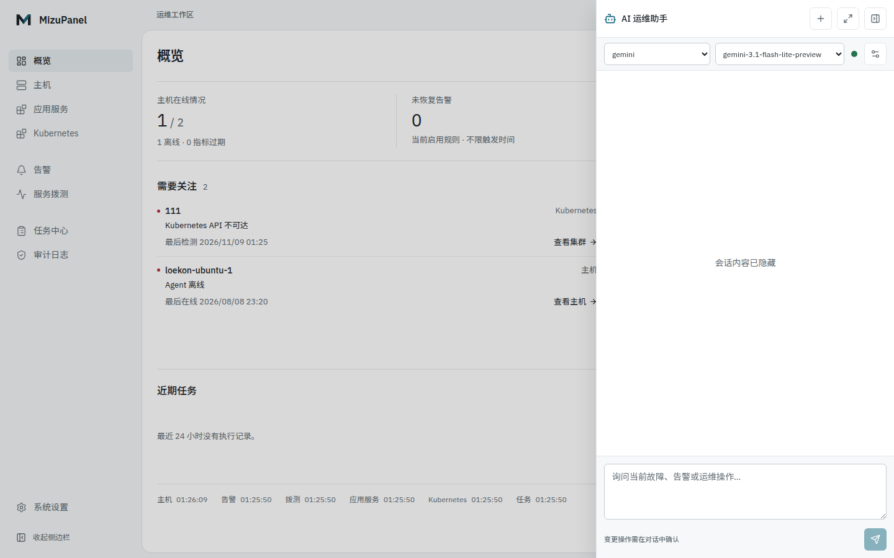</a>
       按需打开的 AI 运维助手。
    </td>
  </tr>
</table>
